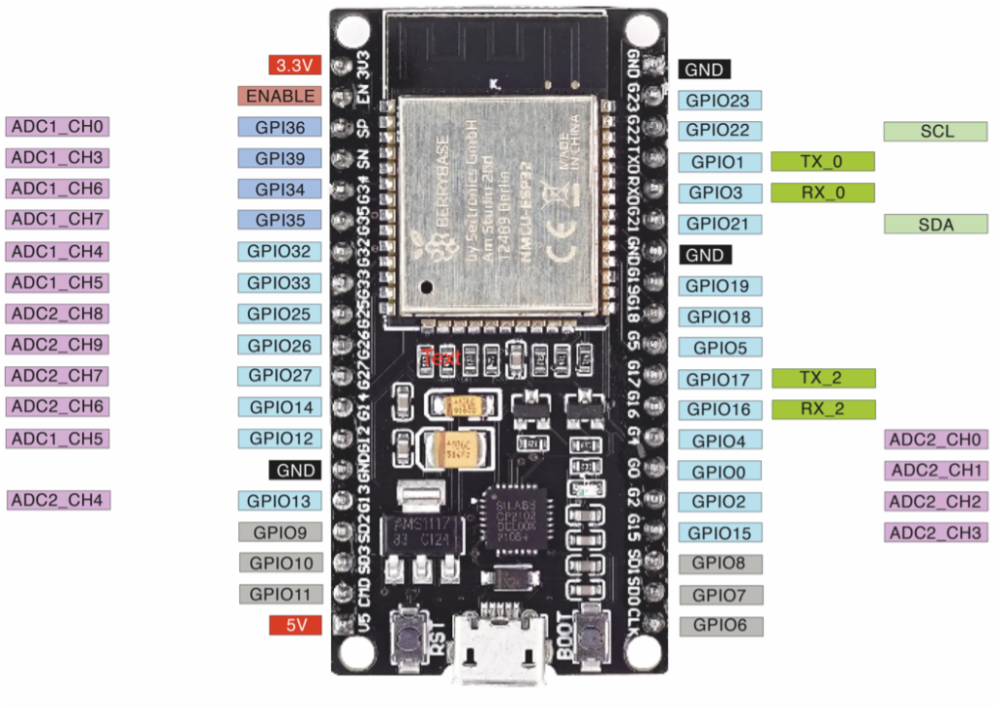
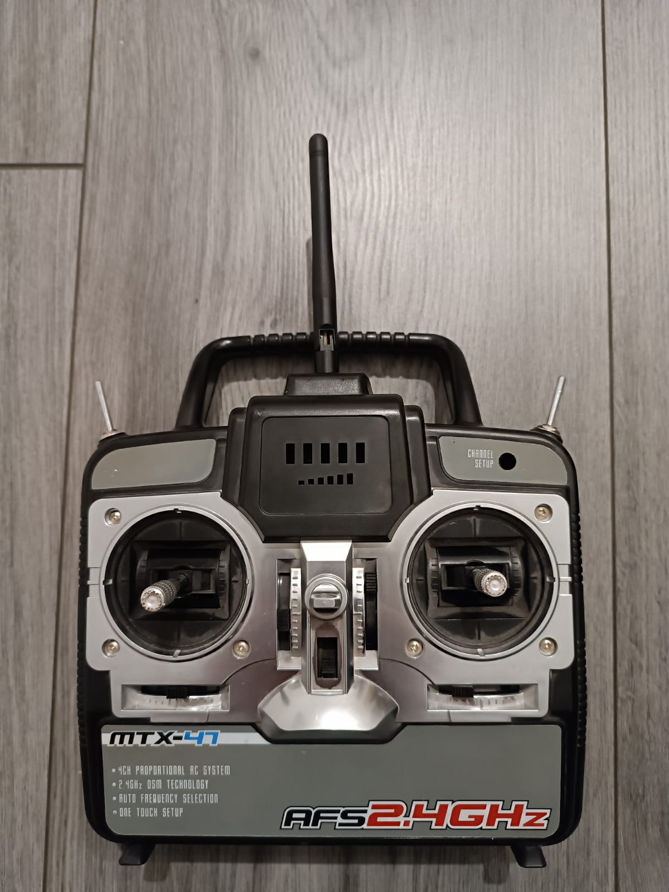

# ESP32: Board, Pinbelegung, Fernbedienung

Stand 16.10.2026. Board-Bild, Fernbedienung und GPIO-Übersicht stammen aus dem Vorgängerprojekt
`arduino-gartenbahn-rc-steuerung-receiver-esp32`, die Pinbelegung ist neu für den Panzer. Sie ist
gegen die Boot- und Peripherie-Regeln des ESP32 geprüft, aber noch nicht vollständig verdrahtet.

## Board

NodeMCU-ESP32 mit 38 Pins (ESP32-WROOM-32, in PlatformIO `board = esp32dev`). Auf einem
WROVER-Modul wären 16/17 vom PSRAM belegt, auf 30-Pin-Boards fehlt GPIO0.



Im Bild ist GPIO12 als ADC1_CH5 beschriftet, richtig ist ADC2_CH5.

Pinout-Referenz: https://lastminuteengineers.com/esp32-pinout-reference/

## Annahmen

- **Turm direkt am Haupt-ESP:** kein Turm-Slave, kein CAN, kein AS5600. Das weicht von den
  Abschnitten Architektur und Turm in [06-antrieb-elektronik.md](06-antrieb-elektronik.md) ab, die
  Entscheidung ist noch offen.
- **Turmlage nur relativ:** Ohne AS5600 und ohne Referenzschalter kennt die Firmware die
  Turmlage nur über gezählte Schritte (z. B. eine PCNT-Unit am STEP-Pin 2). Absolut, etwa für
  „Turm auf 12 Uhr“, erst mit einem Referenzschalter, siehe Reserve unten.
- **TMC2209 im Standalone-Modus:** Strom per Vref, Mikroschritte per MS1/MS2, keine UART.
- **BB-Einheit mit eingebautem Mikroschalter:** Motor über MOSFET, Schalter als Eingang.
- **nRF24 wie im Gartenbahn-Projekt verdrahtet** (Standard-SPI-Pins, CSN 21, CE 22), zusätzlich IRQ.
- **Getriebe links wie auf dem Prüfstand:** 32, 33, 25, 26, 27 sind dieselben Pins wie in
  [src/test_calibration_and_revmatch](../src/test_calibration_and_revmatch/main.cpp).

Nutzbar sind 24 GPIOs, ohne 1/3 (USB-Seriell) und 6–11 (Flash). Belegt sind alle 24, es gibt
keine Reserve.

## Pinbelegung an den Stiftleisten

Ansicht von oben, Antenne oben, USB unten.

| Belegung | Icon | Pin | | Pin | Icon | Belegung |
|---|---|---|---|---|---|---|
| Versorgung 3,3 V | ➕ | 3V3 | | GND | ➖ | Masse |
| Reset | | EN | | 23 | 📡 | nRF24 MOSI |
| Akku-Spannung | 🔋 | 36 | | 22 | 📡 | nRF24 CE |
| BB-Mikroschalter | 💥 | 39 | | 1 | | TX0 (USB) – frei lassen |
| Lichtschranke rechts | 👁️ | 34 | | 3 | | RX0 (USB) – frei lassen |
| nRF24 IRQ | 📡 | 35 | | 21 | 📡 | nRF24 CSN |
| Encoder links A | ⚙️ | 32 | | GND | ➖ | Masse |
| Encoder links B | ⚙️ | 33 | | 19 | 📡 | nRF24 MISO |
| Motor-PWM links | ⚡ | 25 | | 18 | 📡 | nRF24 SCK |
| Motor-DIR links | ↔️ | 26 | | 5 | ⚙️ | Encoder rechts A |
| Lichtschranke links | 👁️ | 27 | | 17 | ↔️ | Motor-DIR rechts |
| Höhenservo | 🎯 | 14 | | 16 | 🔄 | Turm-DIR |
| BB-MOSFET-Gate | 💥 | 12 | | 4 | ⚡ | Motor-PWM rechts |
| Masse | ➖ | GND | | 0 | 🔄 | Turmtreiber ENN |
| Schaltservo | 🕹️ | 13 | | 2 | 🔄 | Turm-STEP |
| Flash | ❌ | 9 | | 15 | ⚙️ | Encoder rechts B |
| Flash | ❌ | 10 | | 8 | ❌ | Flash |
| Flash | ❌ | 11 | | 7 | ❌ | Flash |
| Power IN | ➡️ | 5V | | 6 | ❌ | Flash |

## Pinbelegung nach Baugruppe

| Baugruppe | Signal | GPIO | Beschaltung / Hinweis |
|---|---|---|---|
| Getriebe links | Encoder A / B | 32 / 33 | Encoder an 3V3, nicht 5 V |
| | Motor-PWM | 25 | LEDC-Kanal 2; 10 kΩ Pull-down |
| | Motor-DIR | 26 | LOW = vorwärts (am Prüfstand ermittelt) |
| | Lichtschranke | 27 | Modul an 3V3, die GPIOs sind nicht 5-V-fest |
| Getriebe rechts | Encoder A / B | 5 / 15 | Encoder an 3V3 |
| | Motor-PWM | 4 | LEDC-Kanal 3; 10 kΩ Pull-down |
| | Motor-DIR | 17 | |
| | Lichtschranke | 34 | **externer** 10 kΩ Pull-up nach 3V3, 34 hat keinen internen |
| Schaltung | Schaltservo | 13 | LEDC-Kanal 0; 10 kΩ Pull-down |
| Turm | STEP | 2 | LEDC-Kanal 4 |
| | DIR | 16 | |
| | ENN | 0 | als Open-Drain mit 10 kΩ Pull-up nach 3V3 (nicht 5 V); ein Pull-down des Treibermoduls an EN muss über ~20 kΩ liegen (messen), sonst startet der ESP im Download-Modus |
| | Höhenservo | 14 | LEDC-Kanal 1, nur 50 Hz; 10 kΩ Pull-down |
| BB-Einheit | MOSFET-Gate | 12 | 10 kΩ Pull-down direkt am Gate, nie ein Modul mit Pull-up; bei PWM-Begrenzung LEDC-Kanal 6 |
| | Mikroschalter | 39 | externer Pull-up |
| Funk nRF24 | SCK / MISO / MOSI | 18 / 19 / 23 | Standard-SPI-Pins (VSPI) |
| | CSN | 21 | 10 kΩ Pull-up empfohlen, hält das Modul beim Start abgewählt |
| | CE | 22 | 10 kΩ Pull-down |
| | IRQ | 35 | 10 kΩ Pull-up; laut 06 per Interrupt nutzen, der Gartenbahn-Code pollt nur |
| Akku | Spannung | 36 | Teiler 47 kΩ / 10 kΩ + 100 nF, hinter dem Hauptschalter |

## Gründe für die Zuordnung

- **Boot-Pins** tragen nur Signale, deren Pegel beim Reset passt:
  - GPIO0 muss beim Reset high sein, sonst Download-Modus. ENN mit Pull-up heißt: Treiber aus.
    Beim Flashen zieht die Auto-Reset-Schaltung GPIO0 kurz low, der Turmtreiber ist dann
    bestromt, bewegt sich ohne STEP aber nicht.
  - GPIO2 muss zum Flashen low sein. STEP ruht low.
  - GPIO12 muss beim Reset low sein, sonst wählt der Chip 1,8-V-Flash und bootet nicht. Gate mit
    Pull-down heißt: BB aus.
  - GPIO5 und 15 haben beim Reset einen Pull-up und steuern zusammen nur das SDIO-Timing, GPIO15
    außerdem das Boot-Log. Was der rechte Encoder dort beim Einschalten anlegt, ist für den Boot
    egal. Steht Encoder B (15) beim Einschalten auf low, fehlt nur das ROM-Boot-Log, das ist
    kein Fehler.
- **16/17** spricht der Core beim Booten kurz als PSRAM-Leitungen an. Dort liegen nur DIR-Ausgänge.
  Motor-DIR rechts auf 17 ist harmlos, solange die PWM per Pull-down low ist, Turm-DIR auf 16,
  weil ENN beim Boot high ist.
- **14** wird über den Pull-down beim Reset low gehalten. Berichte über kurze Signale an 14 beim
  Booten sind nicht belegt. Deshalb liegt dort der Höhenservo, der Schaltservo auf dem ruhigen
  Pin 13.
- **34–39** sind reine Eingänge ohne interne Pull-ups. Auf 36/39 erzeugt das Einschalten des ADC
  Glitches von etwa 80 ns. Damit der Mikroschalter auf 39 per Interrupt laufen kann, in `setup()`
  einmal `adc_power_acquire()` aufrufen (aus `<driver/adc.h>`, kostet etwa 1 mA). Die
  Akku-Spannung liegt auf ADC1, weil
  ADC2 bei aktivem WLAN nicht nutzbar ist.
- **LEDC:** Servos auf 0/1 (Timer 0, 50 Hz), Motoren auf 2/3 (Timer 1, 20 kHz), STEP auf 4
  (Timer 2), BB-PWM auf 6 (Timer 3). Kanal 5 frei lassen, er teilt sich den Timer mit STEP. Der
  Höhenservo muss bei 50 Hz bleiben, sonst bleibt ESP32Servo wegen `allocateTimer(0)` in einer
  Endlosschleife hängen.

## Folgen für die Firmware

- `Transmission links(25, 26, 2, 27, 32, 33)`, `Transmission rechts(4, 17, 3, 34, 5, 15)`,
  `Drivetrain drivetrain(links, rechts, 13)`. Reihenfolge der Parameter: PWM, DIR, LEDC-Kanal,
  Lichtschranke, Encoder A, Encoder B.
- `Transmission::init()` setzt für die Lichtschranke `INPUT_PULLUP`. Auf 34 wirkt das nicht, dort
  muss der Pull-up extern sitzen.
- nRF24: `RF24 radio(22, 21)`, SPI mit den Standard-Pins wie im Gartenbahn-Code. `SPI.begin()` fasst
  den Standard-SS-Pin 5 nicht an, solange kein Hardware-CS eingeschaltet wird.
- Die Getriebe sind gespiegelt eingebaut. Ob „LOW = vorwärts“ auch rechts gilt, steht noch aus.
  Werden rechts die Motorleitungen getauscht, damit vorwärts auch vorwärts fährt, zählt der
  Encoder rückwärts, und `calibrate()` bricht an der Plausibilitätsprüfung ab. Dann auch Encoder
  A/B tauschen: `Transmission rechts(4, 17, 3, 34, 15, 5)`.
- Keine Bibliothek mit ihren Standard-Pins starten: `Wire.begin()` belegt 21/22 (nRF CSN/CE),
  `Serial2.begin()` belegt 16/17 (DIR-Leitungen). Für I2C-Bausteine wie INA226 oder eine IMU ist
  kein Pin frei, die gehen nur mit Turm-Slave, Port-Expander oder nach Wegfall eines Signals.
- Ein Potentiometer als Fernbedienungsersatz im Test braucht einen ADC-Pin. Ohne Funk ist 35
  (nRF24 IRQ) frei und liegt auf ADC1.
- Testprogramme: [src/test_servo](../src/test_servo/main.cpp) nutzt für den Servo noch GPIO5, der
  jetzt Encoder rechts A ist, und geht auf 13. Der Gang-Schalter in
  [src/test_calibration_and_revmatch](../src/test_calibration_and_revmatch/main.cpp) liegt auf 14,
  dem späteren Höhenservo. Ist dort der 10-kΩ-Pull-down verbaut, liest der Schalter dauerhaft
  low. Dann den Schalter auf 35 legen, mit externem Pull-up.

Reserve gewinnen, falls später ein Turm-Referenzschalter dazukommt: den nRF-IRQ pollen statt per
Interrupt zu nutzen, wie im Gartenbahn-Code. Das weicht von der Festlegung in 06 ab und ist nur
der Notausgang. Dann wird 35 frei, ein Eingang mit externem Pull-up, passend für einen
Hall-Schalter. TMC-ENN fest auf GND zu legen macht zwar GPIO0 frei
(der Treiber ist dann dauerhaft bestromt, bewegt sich ohne STEP aber nicht), GPIO0 taugt aber nur
für Signale, die beim Reset sicher high sind, also nicht für einen Schalter.

## GPIO-Übersicht

Aus dem Gartenbahn-Projekt übernommen und korrigiert (GPIO2, 5, 14, 15, 16/17, 34–39).

| Bezeichnung | GPIO | Sicher? | Grund |
|---|---|---|---|
| D0 | 0 | ⚠️ | Muss **beim Reset high** sein (Pull-up), low startet den Download-Modus; BOOT-Taste zieht ihn auf low |
| TX0 | 1 | ❌ | TX-Pin, wird zum Flashen und Debuggen verwendet |
| D2 | 2 | ⚠️ | Muss **zum Flashen low oder offen** sein (Pull-down beim Reset); je nach Board mit On-Board-LED |
| RX0 | 3 | ❌ | RX-Pin, wird zum Flashen und Debuggen verwendet |
| D4 | 4 | ✅ | — |
| D5 | 5 | ⚠️ | Strapping-Pin mit Pull-up beim Reset; steuert nur das SDIO-Timing, für den Boot egal |
| D6–D11 | 6–11 | ❌ | Mit dem Flash-Speicher verbunden |
| D12 | 12 | ⚠️ | Muss **beim Reset low** sein, sonst 1,8-V-Flash und der ESP bootet nicht |
| D13 | 13 | ✅ | — |
| D14 | 14 | ✅ | Floatet beim Reset |
| D15 | 15 | ⚠️ | Pull-up beim Reset; steuert mit GPIO5 das SDIO-Timing, low schaltet das Boot-Log ab |
| RX2 | 16 | ⚠️ | Auf WROOM frei, wird beim Booten kurz vom PSRAM-Test angesprochen; auf WROVER belegt |
| TX2 | 17 | ⚠️ | wie 16 |
| D18 | 18 | ✅ | — |
| D19 | 19 | ✅ | — |
| D21 | 21 | ✅ | — |
| D22 | 22 | ✅ | — |
| D23 | 23 | ✅ | — |
| D25 | 25 | ✅ | — |
| D26 | 26 | ✅ | — |
| D27 | 27 | ✅ | — |
| D32 | 32 | ✅ | — |
| D33 | 33 | ✅ | — |
| D34 | 34 | ⚠️ | Nur Eingang, keine internen Pull-ups |
| D35 | 35 | ⚠️ | Nur Eingang, keine internen Pull-ups |
| VP | 36 | ⚠️ | Nur Eingang, keine internen Pull-ups; Glitch beim Einschalten des ADC |
| VN | 39 | ⚠️ | Nur Eingang, keine internen Pull-ups; Glitch beim Einschalten des ADC |

ADC2 (GPIO 0, 2, 4, 12–15, 25–27) ist bei aktivem WLAN nicht als Analogeingang nutzbar, nur ADC1
(GPIO 32–39).

## Fernbedienung



Der Sender aus dem Gartenbahn-Projekt, ein umgebauter MTX-47. Der Aufdruck „DSM“ stammt vom
Original, gefunkt wird per nRF24. Das ist aus dem Gartenbahn-Empfänger erschlossen, der nur RF24
nutzt. Die Sender-Firmware liegt in keinem der beiden Repos.

Basis für den Panzer ist das Gartenbahn-Paket: Adresse `00100`, 10 Byte, RF24-Standardwerte
(1 Mbps, Kanal 76):

```cpp
struct __attribute__((packed)) Data_Package {
  uint16_t lx;  //Stick links X, 0..1023
  uint16_t ly;  //Stick links Y
  uint8_t  lz;  //Schalter links
  uint16_t rx;  //Stick rechts X
  uint16_t ry;  //Stick rechts Y
  uint8_t  rz;  //Schalter rechts
};
```

Für den Failsafe aus [06-antrieb-elektronik.md](06-antrieb-elektronik.md) muss es um
Sequenznummer, Arm-Kommando und BB-Freigabebit erweitert werden; Datenrate und Kanal ebenfalls
laut 06. Die Belegung für den Panzer ist noch offen:

| Bedienelement | Belegung Panzer |
|---|---|
| Stick links, X-Achse | offen |
| Stick links, Y-Achse | offen |
| Stick rechts, X-Achse | offen |
| Stick rechts, Y-Achse | offen |
| Schalter links | offen |
| Schalter rechts | offen |
